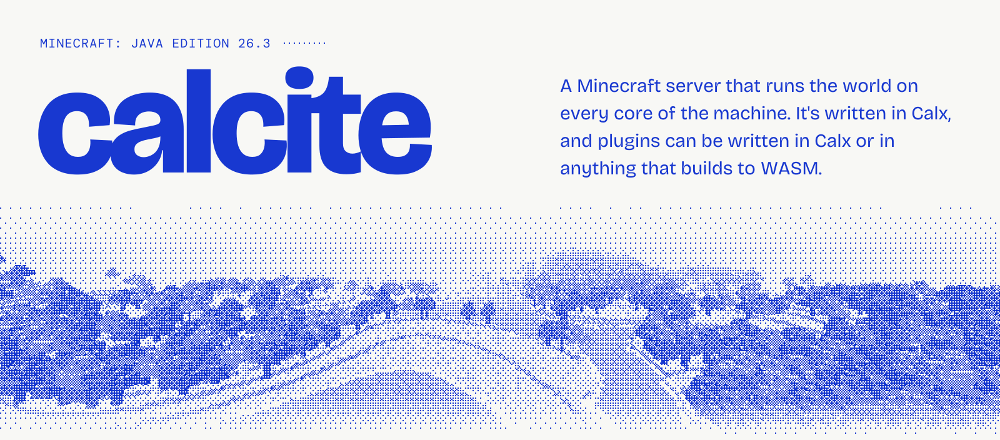

A Minecraft Java Edition server written from scratch in [Calx](https://calxlang.com). It targets 26.3.

Goals:

- **Plugin development.** Native Calx plugins at full speed and sandboxed WASM addons, both built against one documented host API.
- **Performance.** Folia-style regions on every core, ticking in lockstep so results never depend on the thread count.
- **Vanilla parity.** Worldgen matches block for block and behavior matches vanilla, checked bit for bit by an oracle rig. Bugs and exploits are fixed and listed.

Status: Phases 0 to 5 have passed their gates, and Phase 6, simulation, is next. Before Phase 5 came the design, the oracle rig, the data tables generated from the vanilla jar, the Calx compiler core, and the protocol: Mojang's own 26.3 client joins in online mode, walks and chats with signed chat, the login and configuration suites match vanilla packet for packet, and a recorded session replays exactly. Calx runs the Phase 3 tick-loop benchmark in about 0.7× the time of its Rust reference ([results](https://github.com/ellipog/calx#performance)).

Phase 5 made the world: chunks, storage, regions and worldgen. On the [benchmarks](bench/README.md)' reference machine, an i9-13900K:

- **Worldgen matches vanilla.** The Overworld, the Nether and the End pass the worldgen suites on the rig's seed grid. With Terralith and Terratonic, every one of 264 sampled chunks has what must be vanilla's; the blocks that differ are those the order chunks are decorated in decides, which vanilla doesn't fix either.
- **Worlds round-trip** between vanilla and Calcite, and one region thread and many give identical results from the same input log.
- **Generation:** on the [worldgen benchmark](bench/README.md#worldgen-benchmark), with Terralith and Terratonic, set up as C2ME's own benchmark is, Calcite pregenerates 60.8 chunks a second through the whole server on one thread, 389.7 on 8 and 746.0 on 32. On the same machine, C2ME makes 48.8, 312.5 and 687.1, Paper 52.8, 313.7 and 312.5, and vanilla 37.9, 98.0 and 112.9. Without the packs, Calcite makes 1,690 chunks a second of vanilla's own worldgen on 32 threads.
- **A real client:** Mojang's client joining a new world at view distance 32 has all 3,725 chunks in 3.2 s. Flying at 25 times vanilla's speed, 268 blocks a second, it has 97.2% of its view on average and never less than 88.3%.
- **Memory:** the server holds 77 MiB idle, 364 MiB with one still view-32 player, and at most 1,134 MiB while that player flies at 25×.
- **Light** is 1.6 to 1.8 times as fast as vanilla's engine on the rig's terrain workloads, with the same light to the nibble.

Acta board: aaen-studios/calcite ([open](https://acta.aaenz.no/aaen-studios/calcite)). Calx has its own board, aaen-studios/clx ([open](https://acta.aaenz.no/aaen-studios/clx)). The phase gates live here.

## Docs

- [Build plan](docs/PLAN.md): phases, tasks and gates
- [Decision log](docs/decisions.md): everything that's settled, and why
- [Pregenerating chunks](docs/pregen.md): `/pregen`, Chunky built in
- [Host API sketch](plugins/api/HOST_API.md): the plugin contract
- [Source](src/README.md): Calcite's Calx modules and their tests
- [Oracle rig](rig/README.md): how Calcite is checked against vanilla, bit for bit
- [Benchmarks](bench/README.md): the server timed with 100 players, per commit; generating a world, with Terralith and Terratonic beside vanilla, Paper and C2ME, and without; Mojang's own client joining and flying, with the server's memory; and the light engine against vanilla's
- [Data generator and tables](oracle/datagen/README.md): the tables Calcite's codegen reads, generated from the jar

## License

MIT. Calcite contains no Mojang code or assets. It reads vanilla's data from Mojang's official client jar: from the game's copy if it's installed, or else by downloading just the part of the jar that holds the data, the first time it starts.
