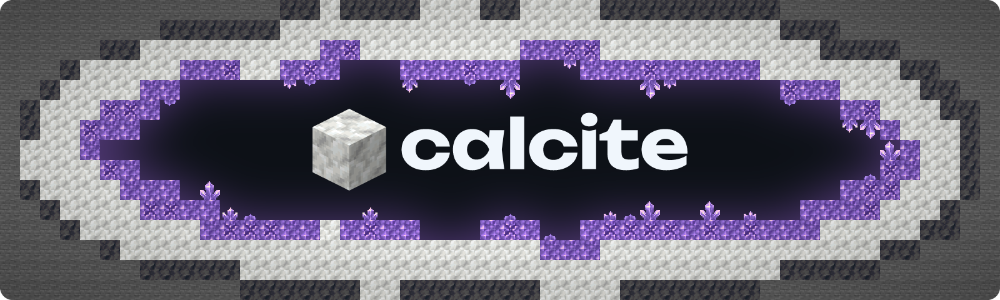

A Minecraft Java Edition server written from scratch in [Calx](https://github.com/ellipog/calx). It targets 26.3.

Goals:

- **Plugin development.** Native Calx plugins at full speed and sandboxed WASM addons, both built against one documented host API.
- **Performance.** Folia-style regions on every core, ticking in lockstep so results never depend on the thread count.
- **Vanilla parity.** Worldgen matches block for block and behavior matches vanilla, checked bit for bit by an oracle rig. Bugs and exploits are fixed and listed.

Status: Phases 0 to 3 have passed their gates: the design, the oracle rig, the data tables generated from the vanilla jar, and the Calx compiler core. Phase 3 is done, and Phases 0 to 2 are in review. Calcite's first Calx code, vanilla's random sources, passes the rig's `rng` probe bit for bit on Windows and Linux. Calx runs the Phase 3 tick-loop benchmark in about 0.7× the time of its Rust reference ([results](https://github.com/ellipog/calx#performance)). Phase 4 has passed its gate: Mojang's own 26.3 client joins a flat world in online mode, walks and chats with signed chat, the login and configuration suites match vanilla packet for packet, and a recorded session replays exactly.

Acta board: aaen-studios/calcite ([open](https://acta.aaenz.no/aaen-studios/calcite)). Calx has its own board, aaen-studios/clx ([open](https://acta.aaenz.no/aaen-studios/clx)). The phase gates live here.

## Docs

- [Build plan](docs/PLAN.md): phases, tasks and gates
- [Decision log](docs/decisions.md): everything that's settled, and why
- [Host API sketch](plugins/api/HOST_API.md): the plugin contract
- [Source](src/README.md): Calcite's Calx modules and their tests
- [Oracle rig](rig/README.md): how Calcite is checked against vanilla, bit for bit
- [Bot benchmark](bench/README.md): the server timed with 100 players, per commit
- [Data generator and tables](oracle/datagen/README.md): the tables Calcite's codegen reads, generated from the jar

## License

MIT. Calcite contains no Mojang code or assets. It reads vanilla's data from Mojang's official client jar: from the game's copy if it's installed, or else by downloading just the part of the jar that holds the data, the first time it starts.
